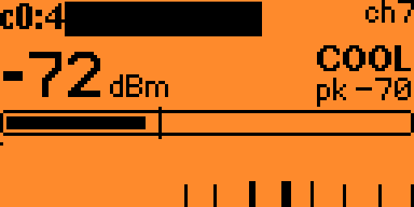
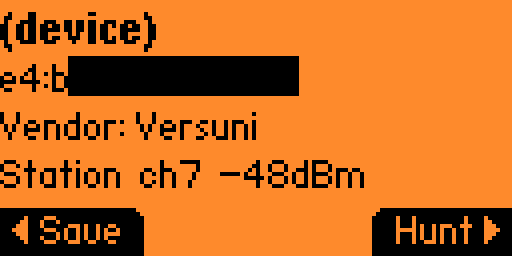

# Wavehound

**WiFi fox hunting for the Flipper Zero WiFi dev board.**

Wavehound uses the Flipper and its ESP32-S2 WiFi dev board to locate a 2.4 GHz
WiFi transmitter by its signal strength. Pick an access point or other device
from a live scan that fills as they are heard, or type in a MAC by hand, then
walk around: the
Flipper clicks faster, the meter fills and the board's RGB LED shifts from blue
to red as the signal gets stronger.

<p align="center">
  
  
</p>

Typical uses:

- Find that forgotten access point, repeater or IoT plug hidden in a ceiling or closet.
- Track down a rogue AP on a network you administer.
- Locate your own lost phone, smart plug or camera by its MAC.
- See which 2.4 GHz channel is least congested before you configure your router.

Wavehound is **receive-only by default**: it reads frame headers to measure
signal strength and never transmits — with one opt-in exception for hunting
devices that are almost always silent (see [Hunting silent
devices](#hunting-silent-devices-optional)). It ships its own board firmware rather than building on
[ESP32 Marauder](https://github.com/justcallmekoko/ESP32Marauder) because of what
Marauder's fox hunt leaves out on a screenless board like the WiFi dev board: its
channel logic — park on the target's channel, sweep to find it, re-acquire when
it goes quiet — lives in the on-device TFT code, which is compiled out of the
dev-board build. What is left just reports RSSI on whatever single channel the
hunt started on: it can't sweep to find a target whose channel you don't know,
and it won't follow one that moves channel. Its AP/station scan likewise hops
every channel with no way to pin it, which makes finding a specific AP's clients
slow and loose. Wavehound's firmware does all of that channel work — park,
sweep-until-heard, re-acquire, and a strict client filter — which is what makes
close-in fox hunting of an occasional transmitter practical. (A Flipper app can
perfectly well drive a board over UART — this split is about capability on the
board, not about where the code can run.)

```
┌──────────── Flipper Zero ─────────────┐        ┌──── WiFi dev board (ESP32-S2) ─────┐
│  Wavehound.fap                        │  UART  │  Wavehound firmware                │
│   ├ Targets: AP search, device search,│ 115200 │   ├ live scan, AP/STA filter       │
│   │  manual MAC entry                 │◄──────►│   │  → target list                 │
│   ├ Hunt view: dBm, meter, graph,     │  pins  │   ├ promiscuous RX → RSSI of target│
│   │  Geiger clicks (speaker)          │ 13/14  │   ├ channel sweep → activity       │
│   ├ Spectrum view: ch 1-13 bars       │        │   └ RGB LED heat indicator         │
│   └ 5V OTG on, expansion svc off      │        │                                    │
└───────────────────────────────────────┘        └────────────────────────────────────┘
```

## Features

| Mode | What you see |
|------|--------------|
| **Hunt access point** | The board listens on every channel and the list fills live, adding each access point as it is heard (by SSID; hidden networks show their BSSID). Pick one the moment it appears or keep waiting as long as you like — no duration to choose. New entries append to the bottom so your highlight stays put while you browse. Pick one to open its details (vendor, type, signal), then hunt. |
| **Hunt devices** | First pick the scope: **All channels (hop)**, **Channel 1–13** (every device on that channel), or **Clients of nearby AP…**, which runs an AP scan so you can pick a network and then lists only the stations associated with it, on its channel. The list then fills live, with access points left out. You get the other transmitters: phones, laptops, smart plugs, cameras. `*` marks a randomized (privacy) MAC that may change over time. Pick one to open its details (vendor, type, signal), then hunt. If you fixed the channel, the hunt stays on it. |
| **Enter MAC** | Type a MAC on the hex keypad (pre-filled with your last target), then pick the channel the same way: **Auto (hop until heard)**, a channel number, or a nearby AP's channel. A chosen channel is pinned: the board stays there even while the target is quiet. Clients always use their AP's channel, so the AP option is the quick way to hunt a known client. |
| **Device details** | After picking a scan result you get a details screen: SSID/name, MAC, **vendor** (resolved from the MAC's OUI), AP or station, channel, and signal. For access points it also shows the security (Open/WEP/WPA/WPA2/WPA3) and 802.11 mode (g/n/ac/ax), e.g. `AP ch6 WPA2 n -52dBm`. **Hunt** continues to the hunt; **Save** stores it as a favorite. Randomized MACs show `randomized` instead of a vendor. Vendor resolution needs the `oui.db` database; without it, other MACs show "Unknown" (see [Vendor database](#vendor-database)). (Security and 802.11 mode need board firmware v7.) |
| **Hunt screen** | The board parks on the target's channel and reports the signal strength of every frame that MAC sends (beacons, data, probes) every 100 ms. The screen shows a big dBm readout with the frame rate (frames/s) beside it, a COLD/COOL/WARM/HOT! label with a trend arrow for whether the signal is rising or falling as you move, a meter with peak and noise-floor markers, the noise floor value (`nf`), and a 12-second signal graph. Geiger clicks play through the speaker, faster as the signal gets stronger. `?ch` in the corner means the board is still searching channels; once a heard target goes quiet, a `quiet Ns` timer counts the silence, and after 8 s (configurable as **Re-search**) it hops again to re-find the target. Press **Right** to save the current target as a named favorite. When you are logged in to the target's access point and its IP is known, the header shows the device's resolved hostname, its type (e.g. Chromecast, Printer) or its IP and **Down** toggles an elicitation ping to coax frames out of a silent device (see [Hunting silent devices](#hunting-silent-devices-optional)). An optional haptic buzz, a kept-on backlight and the meter's Near/Normal/Far range are all configurable under **Settings**. (The noise floor needs board firmware v6.) |
| **Saved MACs** | Favorites you saved from the hunt screen, kept on the SD card (`/ext/apps_data/wavehound/saved.txt`). Pick one for **Hunt / Edit / Delete**. Hunt opens the channel picker with the saved channel pre-selected, so you can accept it, choose another, or switch to Auto. Edit fixes the name, MAC or channel (each field pre-filled). Delete removes it. Saving a randomized (`*`) MAC is of little use since it rotates. |
| **Saved APs** | Access-point passwords you chose to save during login (see [Hunting silent devices](#hunting-silent-devices-optional)), kept on the SD card (`/ext/apps_data/wavehound/aps.txt`). Pick one to **Edit password** or **Delete**. Credentials are stored in plaintext, exactly like saved MACs — the Flipper SD card is not encrypted, so treat it accordingly. |
| **Channel spectrum** | The board sweeps channels 1–13 (120 ms dwell each) in promiscuous mode. The Flipper draws one bar per channel with peak hold, a sweep cursor, the busiest channel, and the number of distinct transmitters heard per sweep. You can switch the metric between packets, max dBm and bytes. |
| **Board info** | Ask the board about itself: firmware build (date + ELF hash), the ESP-IDF version actually running, chip model/revision/cores, radio features, factory MAC, flash size, the app partition and how much of it the current firmware uses, free/min heap, uptime, chip temperature and the last reset reason (handy for spotting brownouts from the 5 V boost). |
| **Settings** | Tweak how the hunt behaves; kept on the SD card (`/ext/apps_data/wavehound/settings.txt`). **Click volume** (0.1–1.0) sets the Geiger click loudness. **Sound** (On/Muted) is the hunt screen's starting mute state. **Saved hunt ch** (Saved / Auto-hop / Nearby AP) is which channel option is pre-selected when you hunt a saved MAC. **Range** (Near / Normal / Far) shifts the dBm window the meter spans — Near −75..−25, Normal −95..−30, Far −100..−50 — and so retunes the click and haptic rate. **Haptic** (Off/On) buzzes the Flipper as a proximity cue, faster as the signal strengthens (works even when muted). **Keep backlight** (Off/On) holds the backlight on while a hunt is on screen. **Hop dwell** (100 ms–2 s, default 300 ms) is how long a hunt stays on each channel while searching for the target: shorter finds an access point faster, longer catches quiet stations. **Re-search** (4–60 s, default 8 s) is how long a locked hunt tolerates silence before searching the channels again. **Response** (Fast / Normal / Smooth) sets how quickly the meter follows the signal. **Scan dwell** (120 ms–2 s) is how long a scan stays on each channel. **Ping interval** (50 ms / 100 ms / 250 ms / 500 ms / 1 s, default 250 ms) is how often the optional elicitation ping pokes a silent target (see [Hunting silent devices](#hunting-silent-devices-optional)). **Reset to defaults** restores everything. (The three timing settings need board firmware v8; older firmware keeps 300 ms / 8 s / 120 ms.) |

Controls:

- **Hunt:** OK = mute/unmute, Left = reset peak, Right = save target, Down = toggle the elicitation ping (only when logged in and the IP is known), Back = return to the list
- **Target list (live scan):** scroll and pick any entry while scanning continues; the first entry, "~ Search again", clears the list and restarts the scan; Back stops scanning and returns
- **Spectrum:** OK/Left/Right = change metric, Back = return to menu

## Hunting silent devices (optional)

A device that rarely transmits gives almost no RSSI samples, so it is hard to
locate. If the device is a client of an access point **you are authorized to
use**, Wavehound can log the board in to that network and gently prompt the
target to reply, turning a silent device into a locatable one.

From **Hunt devices → Clients of nearby AP…**, pick the network and you are
offered a login before its client list is shown:

- **Connect (saved)** — use a password saved earlier (shown only if one exists).
- **Enter password** — type the Wi-Fi password. The stock Flipper keyboard is
  alphanumeric plus `_`, so passwords with other symbols can't be typed by hand;
  use WPS or a saved password for those.
- **WPS (push button)** — press the WPS button on the router; the board enrols
  and captures the credentials.
- **Connect (open)** — for an open network.
- **Skip** — just list the clients, without logging in.

After a successful join you can save the password to **Saved APs** for next
time. The client list and the hunt screen then show each device's **IP** and,
when it can be resolved, a **hostname** and device **type** (best-effort: an
mDNS/Bonjour and UPnP/SSDP query first, which is how a TV or printer becomes
"Living Room TV · Chromecast", then reverse-DNS and NBNS for the rest; the type
needs board firmware v16).

Discovery stays radio-first either way: the client list is built only from
devices actually heard over the air, keyed by MAC. Not logged in, that is all
there is: MACs, signal strength and the vendor guess. Logging in adds a
background sweep — ARP for each heard device's IP, then a few multicast
mDNS/SSDP queries and reverse-DNS/NBNS lookups for its name and type — that only
*annotates* those rows, never adding a host you haven't heard, so anything known
only from the router's relayed reply (including wired devices on the same
network) is deliberately left off. A client still has to transmit to appear and
to be hunted; the elicitation ping below is what coaxes a quiet one into doing so.
The sweep's timing and name precedence are laid out in
[docs/DISCOVERY.md](docs/DISCOVERY.md).

On the hunt screen, **Down** toggles the **elicitation ping**: a rate-limited
unicast request (ARP, plus an ICMP echo) sent to the one target you are hunting,
just often enough that it answers and you get a steady stream of frames to
measure. The rate is capped and set by **Ping interval** in Settings
(50 ms–1 s); the board sends to a single MAC and nothing else. This is **not** a
flood or a denial-of-service tool, and it is deliberately built so it cannot be
turned into one.

> **Authorized use only.** Logging in transmits and joins a network, unlike the
> rest of Wavehound. Only do this on a network you own or are explicitly
> authorized to use, against a device you are authorized to locate. Saved
> passwords are stored in plaintext on the (unencrypted) SD card. Login appears
> with board firmware v9 or newer and the elicitation ping needs v12 or newer;
> the login options are hidden on older firmware. (Prebuilt releases ship the
> matching firmware.)

## Layout

```
firmware/     ESP-IDF project for the ESP32-S2 on the WiFi dev board
  main/main.c     command parser
  main/radio.c    discover / hunt / spectrum state machine + promiscuous callback
  main/info.c     board version / identity / health report (INFO)
  main/proto.c    UART line I/O
  main/led.c      RGB LED (LEDC PWM)
flipper_app/  Flipper external app (uFBT)
  wavehound.c             entry, board power/expansion handling, board line parser
  wh_uart.c               USART worker, line splitting, keep-alive ping
  scenes/                 one file per screen (start, channel select,
                          target list, details, MAC input, hunt, spectrum,
                          board info, name input, saved MACs, saved entry,
                          edit saved, AP login, AP password, AP WPS,
                          AP connect, saved APs, saved AP entry, settings, about)
  wh_store.c              saved MACs: load/add/update/delete on the SD card
  wh_ap_store.c           saved AP passwords: load/add/delete on the SD card
  wh_settings.c           app settings: load/save on the SD card
  wh_oui.c                vendor lookup from the SD oui.db
  views/wh_hunt_view.c    hunt screen + Geiger click thread
  views/wh_spectrum_view.c spectrum screen
  assets/oui.db           bundled vendor database (committed, built from tools/manuf.gz)
tools/gen_oui.py  build oui.db (vendor database) from Wireshark's manuf
tools/manuf.gz    the Wireshark manuf the committed oui.db is built from
tools/package_release.py  collect a release (fap, board bins, notices)
build_app.py      build the app (ufbt); --update-db refreshes the vendor database first
licenses/         GPL-2.0 text for the Wireshark-derived vendor data
docs/PROTOCOL.md  the UART protocol
docs/DISCOVERY.md  logged-in host discovery: sweep passes, listen windows, name precedence
.github/workflows/release.yml  CI build on every branch push; build + publish a release on a v* tag
.github/workflows/toolchain-check.yml  weekly check for a newer Flipper SDK / espressif32 platform (opens an issue)
```

## Vendor database

The device-details screen shows the manufacturer behind a MAC, resolved from
its OUI (the first 3 bytes). Vendor names come from `oui.db`, a sorted
fixed-width binary (a small header, then 16-byte records: 3-byte OUI + name)
the app binary-searches by seeking, so it stays fast and never loads into RAM.

<p align="center">
  
</p>

`oui.db` is checked in as `flipper_app/assets/oui.db`, together with the
Wireshark `manuf` it is built from (`tools/manuf.gz`), so every build has it,
including the Flipper Apps Catalog build. The manifest bundles that folder
(`fap_file_assets`), so the Flipper unpacks it to
`/ext/apps_assets/wavehound/oui.db` when the app is installed.

The app looks for the database in two places, in order:

1. `/ext/apps_data/wavehound/oui.db` — your own drop-in (overrides, newer data)
2. `/ext/apps_assets/wavehound/oui.db` — the bundled copy

So it works out of the box, and you can refresh the data without rebuilding by
dropping a newer `oui.db` in `apps_data` (`python3 tools/gen_oui.py --download
-o oui.db` makes one; files in the older header-less format with 32-byte
records still work too). Without any database, non-randomized MACs show
"Unknown"; randomized (`*`) MACs show `randomized`.

To refresh the bundled copy, run `python3 build_app.py --update-db`. It
downloads the latest `manuf` into `tools/manuf.gz` and regenerates `oui.db`;
commit both files together. CI fails if `oui.db` doesn't match
`tools/manuf.gz` byte for byte.

The data comes from Wireshark's `manuf` (derived from the IEEE registry) and is
GPL-2.0-or-later, as is `oui.db`, which is derived from it. Neither file is under
Wavehound's MIT license; see [THIRD_PARTY_NOTICES.md](THIRD_PARTY_NOTICES.md).

## Prebuilt releases

Each [GitHub release](https://github.com/MatKier/flipperzero-wavehound/releases)
ships `wavehound.fap` (with the vendor database bundled) and the board firmware:
`wavehound-esp32s2-fw<N>-full.bin` to flash at `0x0`, plus the separate
bootloader / partition table / app images. `FLASHING.txt` in the release has
the esptool commands. To build it yourself instead, follow the steps below.

## 1. Flash the dev board firmware

The firmware is built with **PlatformIO**, which pulls its own ESP-IDF
toolchain, so you don't need a separate ESP-IDF install. Verified building with
PlatformIO + ESP-IDF 6.1.

Install PlatformIO Core once with [pipx](https://pipx.pypa.io/) (e.g.
`apt install pipx` or `brew install pipx`, then `pipx ensurepath`):

```bash
pipx install platformio      # later: pipx upgrade platformio
```

Plain `pip install` into the system Python is refused on most current distros
(`externally-managed-environment`); if you don't use pipx, `pip install
platformio` inside a venv works too.

Check it runs:

```bash
pio --version
```

> If `pio` fails with `No module named 'requirements'`, an unrelated PyPI
> package named `pio` is shadowing PlatformIO's command. Remove it and restore
> PlatformIO's launcher: `pipx uninstall pio && pipx reinstall platformio`
> (in a venv: `pip uninstall -y pio && pip install --force-reinstall --no-deps platformio`).

Put the board in **download mode**: hold **BOOT**, tap **RESET**, release
**BOOT**, then connect the board to your PC with its own USB-C port (directly,
not through the Flipper).

Find the serial port:

```bash
pio device list
```

The dev board appears as an Espressif / USB serial device (e.g. `COM5` on
Windows, `/dev/ttyACM0` or `/dev/ttyUSB0` on Linux, `/dev/cu.usbmodem*` on
macOS). Note it. The **Flipper also shows up as a serial port**, so be sure to
pick the ESP32-S2, not the Flipper.

Build, then flash (replace `COM5` with your port):

```bash
cd firmware
pio run                                  # build only
pio run -t upload --upload-port COM5     # build and flash
```

Omitting `--upload-port` lets PlatformIO auto-detect, but naming it explicitly
makes sure you never write to the Flipper's port. If the upload can't enter the
bootloader by itself, redo the BOOT+RESET step right before uploading.

Change pins, baud, LED or max channel (e.g. 11 for US-style regions):

```bash
cd firmware
pio run -t menuconfig
```

Tap **RESET** after flashing to boot the new firmware.

> The defaults assume the official board: UART0 on GPIO43/44 to Flipper
> pins 13/14, and an active-low RGB LED on GPIO6/5/4 (R/G/B). If your clone
> differs, change them in menuconfig.

## 2. Build and install the Flipper app

From the repo root, `build_app.py` runs `ufbt` for you, with the committed
vendor database bundled:

```bash
pipx install ufbt   # or: pip install ufbt inside a venv
python3 build_app.py            # build -> flipper_app/dist/wavehound.fap
python3 build_app.py --launch   # build, upload over USB and run
```

Other options:

```bash
python3 build_app.py --update-db            # download the latest manuf, regenerate the db, then build
python3 build_app.py --manuf path/to/manuf.gz  # regenerate the db from a local manuf.gz instead
python3 build_app.py --update-db --no-build # only refresh the db
```

(`tools/gen_oui.py` is the underlying generator if you want to run it directly.)
Running `ufbt` in `flipper_app/` directly also works and bundles the same
committed `oui.db`.

Or copy `flipper_app/dist/wavehound.fap` to `SD:/apps/GPIO/` with qFlipper, the same
folder a Flipper Apps Catalog install uses (`fap_category="GPIO"`). The app shows up
under **Apps → GPIO → Wavehound**. Built against official firmware SDK 1.5.1
(API 88.2).

## 3. Use it

1. Plug the dev board onto the Flipper and open Wavehound. The app turns on
   5 V on the GPIO header and takes over the USART from the expansion service.
2. The menu header changes to **"Wavehound - board OK"** once the board answers.
3. Pick a target: **Hunt access point**, **Hunt devices** or **Enter MAC**.
   Then start walking. Hold the Flipper away from your body and turn slowly.
   Your body blocks the signal, so the strongest reading points toward the
   source. **Settings** (also on the menu) tunes clicks, haptics, backlight
   and the meter range.

Hunting phones and other client devices works best while they are in use. An
idle phone may only transmit every few seconds, so the readout updates in
bursts. Phones also rotate randomized MACs (`*`), so a MAC you found yesterday
may not exist today.

## Protocol

The link is a plain-text, line-based protocol, so you can test the board from
any serial terminal. See [docs/PROTOCOL.md](docs/PROTOCOL.md). Example:

```
> HUNT,a4:2b:b0:11:22:33,6
< OK,HUNT
< H,6,9,-47,-48,-45,1,-95       # last fields: locked, noise floor (dBm)
> DISCOVER,AP            # scan continuously; AP filter, hop all channels
< OK,DISCOVER
< DISCOVER_BEGIN,AP,0
< DEV,a4:2b:b0:11:22:33,6,-41,93,A2n,HomeNet # streamed as each AP is heard; flags: AP, WPA2, 802.11n
< ...                    # keeps streaming until you STOP
> STOP
< OK,STOP
```

## Disclaimer

This is a hobby project, provided as-is and without any warranty. Everything
here is developed and tested on my own original hardware — a genuine Flipper
Zero and the official WiFi dev board. I can't vouch for clones, other hardware
or other setups: flashing the dev board and running this firmware is at your
own risk, and I don't guarantee it won't damage, brick or otherwise break your
hardware. You are responsible for anything that happens to your Flipper, dev
board or other equipment.

This code is AI-assisted: much of it was written with the help of AI tools.
Review it yourself before trusting it or flashing it to your hardware.

Only locate networks and devices you own or are explicitly authorized to locate,
and only on your own network. Wavehound is receive-only except for the optional
AP login described above, which associates with a network and sends a
rate-limited unicast ping to a single target you choose — use it only on a
network you are authorized to join. Passive reception is legal in most places,
but radio and privacy rules vary by jurisdiction. Checking what you are allowed
to do, and getting permission first, is up to you.

## License

MIT (see [LICENSE](LICENSE)), except for the vendor data: `tools/manuf.gz`
(Wireshark's `manuf`) and the `flipper_app/assets/oui.db` derived from it are
GPL-2.0-or-later. The release binaries also contain
third-party code and data (ESP-IDF and its components, that vendor data); see
[THIRD_PARTY_NOTICES.md](THIRD_PARTY_NOTICES.md).
