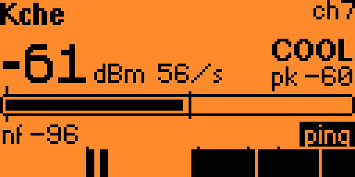
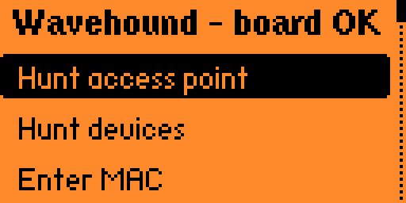
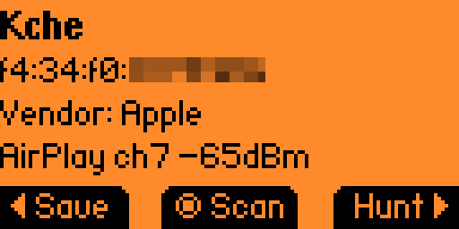

# Wavehound

**WiFi fox hunting for the Flipper Zero WiFi dev board.**

[](https://github.com/MatKier/flipperzero-wavehound/actions/workflows/release.yml)
[](https://github.com/MatKier/flipperzero-wavehound/releases/latest)
[](LICENSE)


Wavehound uses the Flipper and its ESP32-S2 WiFi dev board to locate a 2.4 GHz
WiFi transmitter by its signal strength. Pick an access point or other device
from a live scan, or type in a MAC, then walk around: the Flipper clicks faster,
the meter fills and the board's RGB LED shifts from blue to red as the signal
gets stronger.

<p align="center">
  
  
</p>

More screens are in [docs/SCREENSHOTS.md](docs/SCREENSHOTS.md).
Typical uses:

- Find that forgotten access point, repeater or IoT plug hidden in a ceiling or closet.
- Track down a rogue AP on a network you administer.
- Locate your own lost phone, smart plug or camera by its MAC.
- See which 2.4 GHz channel is least congested before you configure your router.

Wavehound is **receive-only by default**: it reads frame headers to measure
signal strength and never transmits. The one exception is the opt-in login for
[hunting silent devices](#hunting-silent-devices-optional).

**Why its own board firmware?** None of the
[ESP32 Marauder](https://github.com/justcallmekoko/ESP32Marauder) apps that
expose its fox hunt gave me a UX I enjoyed. I
[tried building exactly that](https://github.com/MatKier/flipperzero-marauder-wavehound)
too, but could not get it to work the way I wanted. So Wavehound runs its own
channel logic on the board: park on the target's channel, sweep until it is
heard, and re-acquire it when it goes quiet. It also adds extras such as the
elicitation ping, device metadata and fingerprinting.

```
┌──────────── Flipper Zero ─────────────┐        ┌──── WiFi dev board (ESP32-S2) ─────┐
│  Wavehound.fap                        │  UART  │  Wavehound firmware                │
│   ├ Targets: AP search, device search,│ 115200 │   ├ live scan, AP/STA filter       │
│   │  manual MAC entry                 │◄──────►│   │  → target list                 │
│   ├ Hunt view: dBm, meter, graph,     │  pins  │   ├ promiscuous RX → RSSI of target│
│   │  Geiger clicks (speaker)          │ 13/14  │   ├ channel sweep → activity       │
│   ├ Spectrum view: ch 1-13 bars       │        │   └ RGB LED heat indicator         │
│   └ 5V OTG on, expansion svc off      │        │                                    │
└───────────────────────────────────────┘        └────────────────────────────────────┘
```

## Features

| Menu | What it does |
|------|--------------|
| **Hunt access point** | Lists access points as they are heard on any channel (by SSID; hidden networks by BSSID). |
| **Hunt devices** | Lists everything that is not an access point: phones, laptops, smart plugs, cameras. Pick the scope first: **All channels (hop)**, one **Channel 1–13**, or **Clients of nearby AP…**, which scans for networks and then lists only the stations associated with the one you pick, on its channel. A fixed channel carries over to the hunt. |
| **Enter MAC** | Type a MAC on the hex keypad (pre-filled with the last one), then pick **Auto (hop until heard)**, a channel, or **Channel of nearby AP…**. A chosen channel is pinned: the board stays there even while the target is quiet. Clients always use their AP's channel, so the AP option is the quick way to hunt a known client. |
| **Saved MACs** | Favorites saved from the hunt screen. **Hunt** opens the channel picker with the saved channel pre-selected, **Edit** fixes the name, MAC or channel, **Delete** removes it. |
| **Saved APs** | Wi-Fi passwords saved after a [login](#hunting-silent-devices-optional): **Edit password** or **Delete**. |
| **Channel spectrum** | Sweeps channels 1–13 (120 ms each) and draws a bar per channel with peak hold, a sweep cursor, the busiest channel and the number of distinct transmitters per sweep. OK/Left/Right switch the metric between packets, max dBm and bytes. |
| **Board info** | Firmware version, commit and build, ESP-IDF version, chip, radio features, factory MAC, association and IP, flash and app-partition use, heap, uptime, chip temperature and last reset reason (handy for spotting brownouts from the 5 V boost). |
| **Settings** | See [Settings](#settings). |

**Scan lists** fill live and keep scanning while you browse; new entries append
at the bottom so your highlight stays put, and there is no duration to choose.
`*` marks a randomized (privacy) MAC, which may change over time. The first
entry, **~ Search again**, clears the list and restarts the scan; Back stops
scanning.

**Device details** open when you pick a scan result: name, MAC, **vendor**
(from the MAC's OUI, see [Vendor database](#vendor-database); randomized MACs
show `randomized`), AP or station, channel and signal. For access points it also
shows the security (Open/WEP/WPA/WPA2/WPA3) and 802.11 mode (g/n/ac/ax), e.g.
`AP ch6 WPA2 n -52dBm`. **Hunt** starts the hunt, **Save** stores a favorite,
and **Scan** [fingerprints](#fingerprinting-a-device) the device when you are
logged in.

### Hunt screen

The board parks on the target's channel and reports the signal strength of
every frame that MAC sends (beacons, data, probes) every 100 ms. The screen
shows:

- a big dBm readout with the frame rate (`/s`), a COLD/COOL/WARM/HOT! label
  (SEEK while searching, LOST once a locked target goes quiet) and a trend
  arrow for whether the signal is rising or falling as you move;
- a meter with peak (`pk`) and noise-floor markers, the noise floor value
  (`nf`) and a ~12-second signal graph;
- `?ch` in the corner while the board is still searching channels. Once a heard
  target goes quiet, `quiet Ns` counts the silence, and after **Re-search**
  (default 8 s) the board hops again to re-find it;
- when logged in to the target's AP and its IP is known, the device's hostname,
  type (e.g. Chromecast, Printer) or IP in the header.

Geiger clicks play through the speaker, faster as the signal gets stronger, with
an optional haptic buzz.

Controls: **OK** mute/unmute, **Left** reset peak, **Right** save as a named
favorite, **Down** toggle the [elicitation ping](#hunting-silent-devices-optional),
**Up** [fingerprint](#fingerprinting-a-device) the target (Down and Up only when
logged in and the IP is known), **Back** return to the list.

Hold the Flipper away from your body and turn slowly: your body blocks the
signal, so the strongest reading points toward the source. Phones and other
clients are easiest to hunt while in use; an idle phone may only transmit every
few seconds, so the readout updates in bursts. Phones also rotate randomized
MACs, so saving a `*` MAC is of little use.

### Settings

| Setting | Values (default) | Effect |
|---------|------------------|--------|
| **Click volume** | 0.1–1.0 (0.5) | Geiger click loudness. |
| **Sound** | On / Muted (On) | The hunt screen's starting mute state. |
| **Saved hunt ch** | Saved / Auto-hop / Nearby AP (Saved) | Which channel option is pre-selected when you hunt a saved MAC. |
| **Hop dwell** | 100 ms–2 s (300 ms) | How long a hunt stays on each channel while searching. Shorter finds an AP faster, longer catches quiet stations. |
| **Re-search** | 4–60 s (8 s) | How long a locked hunt tolerates silence before searching again. |
| **Range** | Near / Normal / Far (Normal) | The dBm window the meter spans (−75..−25, −95..−30, −100..−50), which also sets the click and haptic rate. |
| **Response** | Fast / Normal / Smooth (Normal) | How quickly the meter follows the signal. |
| **Scan dwell** | 120 ms–2 s (120 ms) | How long a scan stays on each channel. |
| **Haptic** | Off / On (Off) | Buzz as a proximity cue, faster as the signal strengthens (works even when muted). |
| **Keep backlight** | Off / On (On) | Hold the backlight on while a hunt is on screen. |
| **Ping interval** | 50 ms–1 s (250 ms) | How often the [elicitation ping](#hunting-silent-devices-optional) pokes a silent target. |

**Reset to defaults** at the bottom restores everything.

### Files on the SD card

Everything lives in `/ext/apps_data/wavehound/`: `saved.txt` (saved MACs),
`aps.txt` (saved AP passwords), `settings.txt`, and optionally your own
`oui.db` (see [Vendor database](#vendor-database)). The SD card is not
encrypted and saved passwords are stored in **plaintext**, so treat the card
accordingly.

## Hunting silent devices (optional)

A device that rarely transmits gives almost no RSSI samples, so it is hard to
locate. If it is a client of an access point **you are authorized to use**,
Wavehound can log the board in to that network and prompt the target to reply.

From **Hunt devices → Clients of nearby AP…**, pick the network and you are
offered a login before its client list is shown:

- **Connect (saved)**: a password saved earlier (shown only if one exists).
- **Enter password**: type the Wi-Fi password. The stock Flipper keyboard is
  alphanumeric plus `_`, so passwords with other symbols need WPS or a saved
  password.
- **WPS (push button)**: press the WPS button on the router; the board enrols
  and captures the credentials.
- **Connect (open)**: offered instead of the three above for an open network.
- **Skip (list only)**: list the clients without logging in.

After a successful join you can save the password to **Saved APs**. The client
list, details and hunt screen then show each device's **IP** and, when it can be
resolved, a **hostname** and device **type** (best-effort: mDNS/Bonjour and
UPnP/SSDP first, which is how a TV gets a name like "Living Room TV" and a type
like *Chromecast*, then reverse DNS and NBNS). The list and hunt header show the
type only when there is no name; the details screen shows both.

Discovery stays radio-first: the client list is built only from devices heard
over the air, keyed by MAC. Logging in adds a background sweep (ARP for each
host's IP, then the name lookups) that only *annotates* those rows. A host known
only from the router's relayed reply, such as a wired device, is never added; a
client still has to transmit to appear and to be hunted. The sweep's passes,
timing and name precedence are in [docs/DISCOVERY.md](docs/DISCOVERY.md).

On the hunt screen, **Down** toggles the **elicitation ping**: a unicast ARP
request plus an ICMP echo to the one target you are hunting, at the **Ping
interval** (capped to 50 ms–1 s), so it answers with a steady stream of frames
to measure. It only ever addresses that single MAC. It is **not** a flood or
denial-of-service tool and is built so it cannot be turned into one.

### Fingerprinting a device

When logged in and a device's IP is known, **Scan** on its details screen (or
**Up** while hunting it) makes the board guess what the device is: it tries a
fixed handful of TCP ports (SSH, Telnet, HTTP, HTTPS, SMB, RTSP, HTTP-alt,
JetDirect printer), reads the web page's `Server:` header and title, and shows
the open ports, the web server and a label such as *Network printer*, *RTSP
camera* or *Web service*. HTTPS is noted but not inspected (the board speaks no
TLS). Like the ping it is **active**: one connection attempt per port, once per
press, to the single device you are inspecting. Leaving the result screen
cancels a scan still in progress.

> **Authorized use only.** Logging in, the elicitation ping and fingerprinting
> transmit and join a network, unlike the rest of Wavehound. Only use them on a
> network you own or are explicitly authorized to use, against a device you are
> authorized to locate.

## Board firmware versions

Prebuilt releases ship the matching board firmware. On older board firmware the
app keeps working, but some features need at least:

| Feature | Board firmware |
|---------|----------------|
| Noise floor on the hunt meter | v6 |
| Security and 802.11 mode on the details screen | v7 |
| Hop dwell, Re-search and Scan dwell (older firmware keeps 300 ms / 8 s / 120 ms) | v8 |
| AP login (WPS: v10) | v9 |
| Elicitation ping | v12 |
| Device type from mDNS/SSDP | v16 |
| Fingerprinting | v17 |

The app hides the login below v9 and **Scan** below v17. **Board info** shows
the running version.

## Vendor database

The vendor on the details screen comes from `oui.db`, a lookup table built from
Wireshark's `manuf` and bundled with the app. To use newer data without
rebuilding, drop your own `oui.db` into `/ext/apps_data/wavehound/`; it takes
precedence over the bundled copy. Format, refresh and licensing are in
[docs/VENDOR_DB.md](docs/VENDOR_DB.md).

<p align="center">
  
</p>

## Install

Each [GitHub release](https://github.com/MatKier/flipperzero-wavehound/releases)
ships `wavehound.fap` (vendor database bundled) and the board firmware.

1. **Flash the dev board.** Put it in
   [download mode](docs/BUILDING.md#download-mode) and flash
   `wavehound-esp32s2-fw<N>-full.bin` at `0x0` (the separate bootloader /
   partition table / app images are included too). `FLASHING.txt` in the
   release has the esptool commands. Tap **RESET** afterwards.
2. **Install the app.** Copy `wavehound.fap` to `SD:/apps/GPIO/` with qFlipper,
   the same folder a Flipper Apps Catalog install uses. It shows up under
   **Apps → GPIO → Wavehound**.
3. **Use it.** Plug the dev board onto the Flipper and open Wavehound. The app
   turns on 5 V on the GPIO header and takes over the USART from the expansion
   service; the menu header changes to **"Wavehound - board OK"** once the board
   answers. Pick a target from **Hunt access point**, **Hunt devices** or
   **Enter MAC** and start walking (see [Hunt screen](#hunt-screen)).

To build the firmware and app yourself (PlatformIO, ufbt, menuconfig for pins,
LED and max channel), see [docs/BUILDING.md](docs/BUILDING.md).

## Repository layout

`firmware/` is the board firmware, `flipper_app/` the Flipper app, `tools/` the
vendor-database and release scripts. The file-by-file map is in
[docs/LAYOUT.md](docs/LAYOUT.md).

## Protocol

The link is a plain-text, line-based protocol, so you can test the board from
any serial terminal. See [docs/PROTOCOL.md](docs/PROTOCOL.md). Example:

```
> HUNT,a4:2b:b0:11:22:33,6
< OK,HUNT
< H,6,9,-47,-48,-45,1,-95       # ch, frames, last/avg/max dBm, locked, noise floor
> DISCOVER,AP                   # scan continuously; AP filter, hop all channels
< OK,DISCOVER
< DISCOVER_BEGIN,AP,0
< DEV,a4:2b:b0:11:22:33,6,-41,93,A2n,HomeNet   # each AP as it is heard; flags: AP, WPA2, 802.11n
< ...                           # keeps streaming until you STOP
> STOP
< OK,STOP
```

## Disclaimer

This is a hobby project, provided as-is and without any warranty. Everything
here is developed and tested on my own original hardware: a genuine Flipper
Zero and the official WiFi dev board. I can't vouch for clones, other hardware
or other setups: flashing the dev board and running this firmware is at your
own risk, and I don't guarantee it won't damage, brick or otherwise break your
hardware. You are responsible for anything that happens to your Flipper, dev
board or other equipment.

This code is AI-assisted, as the commit history shows.

Only locate networks and devices you own or are explicitly authorized to
locate. Wavehound is receive-only except for the optional login, elicitation
ping and fingerprint described above. Passive reception is legal in most places,
but radio and privacy rules vary by jurisdiction. Checking what you are allowed
to do, and getting permission first, is up to you.

## License

MIT (see [LICENSE](LICENSE)), except for the vendor data: `tools/manuf.gz`
(Wireshark's `manuf`, derived from the IEEE registry) and the
`flipper_app/assets/oui.db` built from it are GPL-2.0-or-later. The release
binaries also contain third-party code and data (ESP-IDF and its components,
that vendor data); see [THIRD_PARTY_NOTICES.md](THIRD_PARTY_NOTICES.md).
