# Screenshots

Taken with qFlipper on board firmware v17 / app v1.17. In the shots under
[screenshots/](screenshots/) SSIDs, hostnames, IPs and MACs are partly
pixelated (the pixelated part was replaced with random noise first, so it can't
be restored). The ones without identifiers are the unmodified catalog shots in
[flipper_app/catalog/screenshots/](../flipper_app/catalog/screenshots/).

## Menu and access points

| | |
|---|---|
|  | 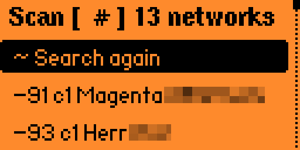 |
| Main menu, once the board answers. | **Hunt access point**: the list fills as networks are heard (dBm, channel, SSID). |
| 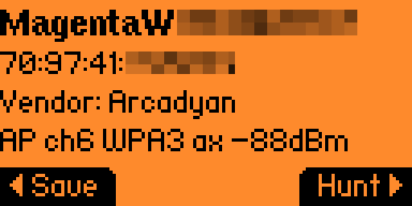 | 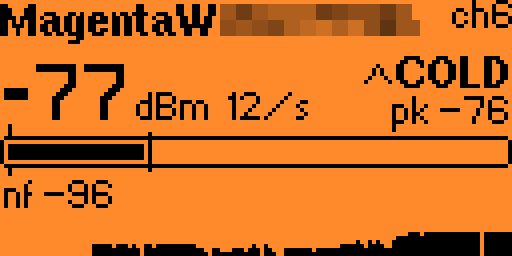 |
| AP details: MAC, vendor, channel, security, 802.11 mode and signal. | Hunting an AP: dBm and frame rate, trend arrow, peak, meter and noise floor. |

## Devices and login

| | |
|---|---|
| 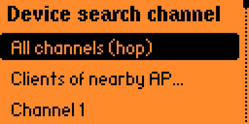 | 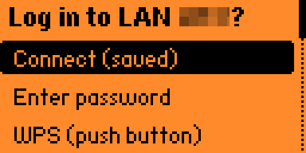 |
| **Hunt devices** scope: all channels, clients of a nearby AP, or one channel. | Login offered after picking an AP for its client list. |
| 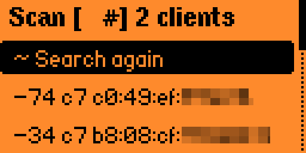 | 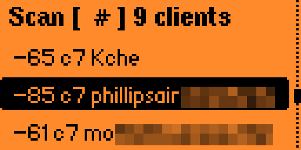 |
| Client list without login (or before lookups finish): MACs only. | Logged in: rows show the resolved hostname, else the IP. |
|  |  |
| Device details with vendor, mDNS type and the **Scan** button. | Fingerprint result: device label, IP and open ports. |
| 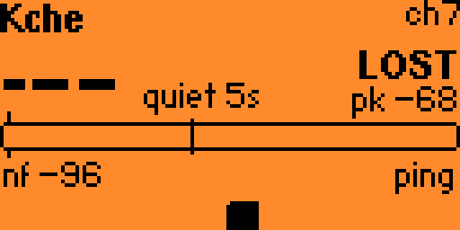 |  |
| Hunting a quiet device: `quiet 5s`, `ping` available (Down). | The same device with the elicitation ping on: a steady stream of frames. |

## Tools

| | |
|---|---|
| 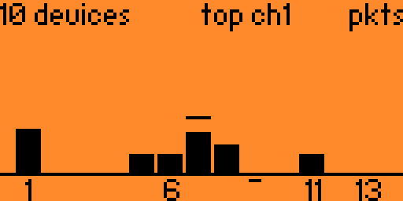 | 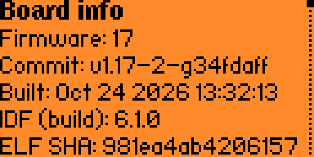 |
| Channel spectrum: packets per channel, peak hold, busiest channel. | Board info: firmware, commit, build, ESP-IDF, ELF hash and more. |
| 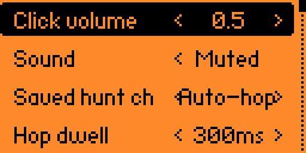 | |
| Settings. | |
